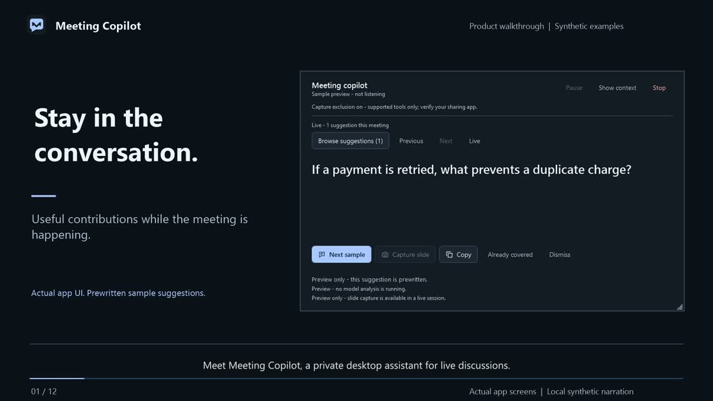

# Meeting Copilot

**Stay in the conversation. Get useful questions and recommendations while the meeting is happening.**

Meeting Copilot is a Windows desktop assistant built with C# and WPF. It listens to
your selected meeting playback device, builds context from finalized speech, and
privately surfaces a grounded recommendation, question, potential gap, or alternative.
You decide what to say: it never speaks or posts to Teams automatically.

It also includes a presentation script library, a voice-follow reader, and a minimal
offline teleprompter that can sit above your slides.

## Watch the two-minute demo

[](https://github.com/asthanarht/meeting-copilot/blob/main/docs/media/Meeting-Copilot-Demo.mp4)

**[Watch or download the demo video](https://github.com/asthanarht/meeting-copilot/blob/main/docs/media/Meeting-Copilot-Demo.mp4)** ·
[English captions](docs/media/Meeting-Copilot-Demo.en.srt)

The 1080p video uses actual app screens, clearly labeled synthetic meeting examples,
local English narration, and burned-in captions. It includes actual offline
teleprompter scrolling; it is not a recording of a real meeting or live model inference.
Click the preview to open the MP4 on GitHub, or download it if your browser does not play it.

## What it does

| Feature | How it helps |
|---|---|
| Live questions and recommendations | Suggests a useful contribution during the discussion, not after it ends. |
| Evidence and uncertainty | Shows why a suggestion matters and the context supporting it. |
| Continuous meeting context | Keeps accepted speech and summary history in memory until Stop, while bounding each model request. |
| Type tags and suggestion history | Distinguish Question, Improvement, Potential gap and Alternative at a glance, both on the current suggestion and in history. Copy, revisit, dismiss or mark it already covered. |
| Multiple AI providers | Choose Foundry, Gemini, Claude, Grok, or an OpenAI-compatible hosted/local model. |
| Approved slide capture | Review a selected slide region before sending it to a supported vision connection. |
| Saved presentation scripts | Save and edit scripts locally with Windows-account encryption. |
| Voice-follow teleprompter | Highlights matched words; silence or unmatched speech holds the reading position. |
| Offline minimal teleprompter | Run, stop, and manually scroll without a microphone, model, or network connection. |
| Private overlay controls | Always-on-top positioning, focus view, adjustable text, and Windows capture-exclusion requests. |

## Supported connections

Speech recognition and meeting analysis are configured separately.

**Speech:** Azure Speech continuous streaming is recommended. MAI-Transcribe-2 short
uploads remain an explicit alternative. Current transcription is English, not translation.

| Meeting AI connection | Authentication | Slide-image analysis |
|---|---|---|
| Microsoft Foundry Responses | Resource API key or Microsoft Entra | Yes, with an image-capable deployment |
| Legacy Azure OpenAI Chat Completions | Resource API key | No |
| Google Gemini Developer API | Gemini API key | Not enabled |
| Anthropic Claude Messages | Anthropic API key | Not enabled |
| xAI Grok Responses | xAI API key | Not enabled |
| OpenAI-compatible cloud/local server | Bearer API key; optional no-key loopback | Not enabled |

Use an exact model/deployment ID supported by your provider. Generic compatible
connections expose JSON format and token-parameter settings; compatibility with
every model is not guaranteed. No automatic provider or model fallback occurs.
The new external adapters have synthetic protocol coverage; live vendor access and
model quality must be checked with your own approved credentials.

## Quick start

### Download the Windows app

Get the portable executable from the **[latest release](https://github.com/asthanarht/meeting-copilot/releases/latest)**:

| Your PC | Download |
|---|---|
| Intel or AMD (most Windows PCs) | [MeetingCopilot-win-x64.exe](https://github.com/asthanarht/meeting-copilot/releases/latest/download/MeetingCopilot-win-x64.exe) |
| Windows on ARM / Snapdragon | [MeetingCopilot-win-arm64.exe](https://github.com/asthanarht/meeting-copilot/releases/latest/download/MeetingCopilot-win-arm64.exe) |

These self-contained executables include .NET; no separate .NET installation or
source build is needed. The native Speech SDK still requires the Microsoft Visual
C++ 2015-2022 Redistributable for your architecture. The executables are **unsigned**;
Windows may show an unknown-publisher warning. Follow your organization's policy
rather than disabling security protections. SHA-256 checksums are included in the release.
No settings, scripts or credentials are bundled. Configure your own providers on first run.

### Requirements

- Windows 11.
- [.NET 10 SDK](https://dotnet.microsoft.com/download/dotnet/10.0) to build and run.
- Microsoft Visual C++ 2015-2022 Redistributable for your target architecture
  (required by the native Azure Speech SDK).
- For live meetings: an approved Azure Speech resource, a supported AI connection,
  and participant consent/workplace permission.
- For the timed offline teleprompter or sample preview: no cloud credentials.

```powershell
git clone https://github.com/asthanarht/meeting-copilot.git
Set-Location meeting-copilot
dotnet run --project .\src\MeetingCopilot.Desktop
```

1. Open **Connections** and enter your Speech endpoint or region and key.
2. Under **Meeting AI**, select a provider and enter its endpoint, model ID and credentials.
3. Use **Test model connection**. It sends synthetic text only, opens no audio devices,
   and may incur provider charges.
4. Select the same playback device used by Teams, optionally enable your microphone,
   and add a brief if useful.
5. Confirm consent and select **Start live overlay**.

Use headphones to reduce playback/microphone echoes. Playback capture includes all
audio on the selected output device, not just Teams. **Try a sample** demonstrates
the interface without audio capture or cloud calls.

For presentations, choose **Open teleprompter**, save a script, then open the full
reader or minimal overlay. Timed mode is offline. Voice following separately sends
microphone audio to Azure Speech after permission; the script and word matching stay local.

### Local model example

Select **OpenAI-compatible**, start your local model server, and configure:

| Server | API base URL |
|---|---|
| Ollama | `http://localhost:11434/v1` |
| LM Studio | `http://localhost:1234/v1` |

Enter the model ID loaded by that server. Choose local no-key authentication when
appropriate; many servers use `max_tokens` rather than `max_completion_tokens`.
HTTP and no-key access are restricted to loopback. Remote endpoints require HTTPS
and an API key. **Local model inference does not make live transcription offline.**

## Privacy and credentials

- **No real credentials, API keys, account settings, or personal scripts are included
  in this repository.** Test credentials are deliberately synthetic placeholders.
- Enter credentials through password fields. Saved keys use Windows DPAPI encryption
  for the current account in `%LOCALAPPDATA%\MeetingCopilot\settings.json`.
- External providers have separate profiles. Switching does not copy credentials;
  changing an external endpoint clears that profile's key.
- Optional environment variables can prefill configuration: `AZURE_SPEECH_KEY`,
  `AZURE_SPEECH_ENDPOINT`, `AZURE_SPEECH_REGION`, `AZURE_OPENAI_ENDPOINT`,
  `AZURE_OPENAI_DEPLOYMENT`, `AZURE_OPENAI_API_KEY`, and `AZURE_TENANT_ID`.
  Set them securely; never put their values in source control.
- Recordings, transcripts, meeting briefs, slide images and suggestion history are
  not persisted by the app. Session context stays in memory until Stop/app exit.
- Provider retention and organizational policies still apply. Foundry and Grok
  Responses requests disable retrievable response storage with `store: false`;
  this does not eliminate all provider logging or retention.
- Clipboard history, sync, and other applications may retain copied suggestions.
- DPAPI protects stored keys, not against other code running as the same Windows user.
  Do not share encrypted settings files either.

**Screen-sharing caveat:** the app requests Windows `WDA_EXCLUDEFROMCAPTURE`; this
is not a guarantee of invisibility in Teams or every capture tool. Verify from another
participant's view before relying on it. Share a specific application window when unsure.

AI suggestions, transcription, and long-meeting recall can be wrong or incomplete.
Review advice before speaking. Voice following is not speaker identification.

## Build and test

```powershell
dotnet build .\MeetingCopilot.slnx -c Release
dotnet test .\tests\MeetingCopilot.Tests -c Release --verbosity minimal

# Windows ARM64; change win-arm64 to win-x64 for Intel/AMD.
dotnet publish .\src\MeetingCopilot.Desktop -c Release -r win-arm64 `
  --self-contained false -o .\artifacts\win-arm64

# Standalone executable matching the release packaging:
dotnet publish .\src\MeetingCopilot.Desktop -c Release -r win-arm64 `
  --self-contained true -p:PublishSingleFile=true `
  -p:IncludeNativeLibrariesForSelfExtract=true -p:EnableCompressionInSingleFile=true `
  -o .\artifacts\release\win-arm64
```

Framework-dependent builds require the .NET 10 Desktop Runtime on the destination
machine. Generated binaries and intermediate files are intentionally excluded from Git.
Tests cover provider protocols, encrypted configuration, session lifecycle, context
retention, WPF controls, capture protection, and teleprompter behavior. Live service
checks are opt-in and can incur charges; the default suite uses synthetic inputs.

## Project structure

```text
src/MeetingCopilot.Core/       Analysis contracts, provider adapters, context and playback logic
src/MeetingCopilot.Desktop/    WPF interface, audio capture, speech, scripts and local settings
tests/MeetingCopilot.Tests/    Unit, integration, WPF and opt-in live checks
docs/media/                   Demo MP4, preview and captions
tools/                        Icon and narrated demo generation
```

See the [user guide](docs/user-guide.md) for configuration, shortcuts, troubleshooting
and demo regeneration, and the [design reference](meeting-overlay-design.md) for UX details.
